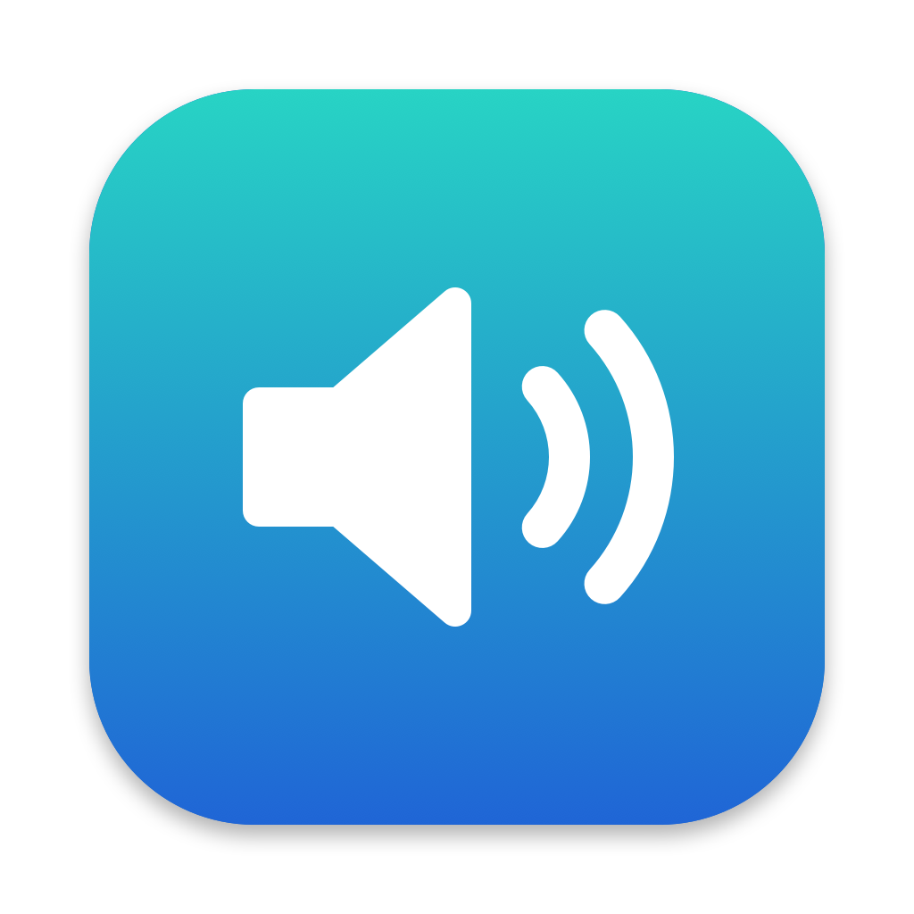
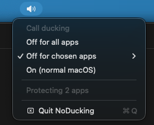

<p align="center">
  
</p>

# NoDucking: stop your Mac lowering other apps' volume during calls (free app for macOS Sonoma, Sequoia and Tahoe)

NoDucking is a free, open source menu bar app that stops audio ducking on your Mac. When you join a call on FaceTime, WhatsApp, Zoom, Google Meet or a similar app, macOS turns everything else down: your music, a YouTube video, a game. NoDucking keeps the apps you choose, or all apps, at full volume while the call is running.

<p align="center">
  
</p>

macOS has no setting to stop audio ducking or turn it off. NoDucking adds that missing switch to the menu bar.

[Download NoDucking for Mac](../../releases/latest)

## Features

- Keeps other apps at their normal volume during calls, instead of the roughly 30 dB drop macOS applies.
- Three modes in the menu bar: off for all apps, off for chosen apps, or on (normal macOS behaviour).
- Remembers the apps you ticked.
- Leaves the call itself alone. In all-apps mode, any app that is using the microphone is skipped.
- No driver, no kernel extension, no virtual audio device to install.
- Free and open source under the MIT licence. No account, no ads, no network code.

## Requirements

- macOS 14.4 Sonoma or later, including Sequoia and Tahoe. Tested on macOS Tahoe so far.
- A Mac with Apple silicon (M1 or newer). Intel Macs are not supported.

## How to stop audio ducking on Mac

### Download the app

1. Download `NoDucking.zip` from the [latest release](../../releases/latest) and unzip it.
2. Drag `NoDucking.app` into Applications and open it.
3. macOS will say it could not verify the app. Open System Settings, go to Privacy & Security, scroll down and press Open Anyway.
4. macOS asks for permission to record system audio. Press Allow. See [Privacy](#privacy) for why NoDucking needs it.
5. Click the speaker icon in the menu bar and choose "Off for all apps".

The app is signed but not notarized by Apple. Notarization needs a paid Apple developer membership, which this project does not have. Building it yourself avoids the warning.

### Build it yourself

An app you build on your own Mac is not blocked by macOS, because it was never downloaded. You need the Xcode Command Line Tools (`xcode-select --install`).

```bash
git clone https://github.com/hammad20120/noducking.git
cd noducking
./build.sh
open build/NoDucking.app
```

To keep it, drag `build/NoDucking.app` into your Applications folder.

## Using it

Click the speaker icon in the menu bar and pick a mode under "Call ducking".

| Mode | What happens |
|---|---|
| Off for all apps | Every app keeps its volume during calls, except apps that are using the microphone. |
| Off for chosen apps | Only the apps you tick in the submenu keep their volume. |
| On (normal macOS) | NoDucking does nothing. macOS ducks as usual. |

An app shows up in the list once it has played some audio. Do not tick the call app itself. Tick the apps you want protected from it.

## NoDucking compared with other ways to stop call ducking

| | NoDucking | Unduck Pro | Unduck | macOS settings |
|---|---|---|---|---|
| Price | Free | Free | Free | Built in |
| Open source | Yes (MIT) | Yes (MIT) | Yes (MIT) | No |
| Calls it covers | Any app that uses macOS voice processing | FaceTime, Zoom and Meet, per its description | FaceTime | No setting for calls |
| Which apps stay loud | All apps, or the ones you tick | Per-app volume mixer | Other audio during FaceTime | None |
| Download | Zip, or build from source | DMG | DMG | None |
| Extras | None | Per-app volume mixer | None | None |

NoDucking does one thing: it stops call ducking, with nothing else added. If you also want a per-app volume mixer, Unduck Pro offers one.

## Questions

### Why does my Mac lower the volume during calls?

Call apps turn on macOS voice processing, the feature that removes echo and background noise. Voice processing deliberately turns down every other sound so the call is easier to hear. Only the call app can change how strongly it does this, and most give you no option.

### How do I stop FaceTime from lowering the volume of other apps on Mac?

macOS has no switch to prevent it. Install NoDucking and choose "Off for all apps". It plays the other apps' sound in a way macOS does not turn down.

### How do I stop a WhatsApp call lowering the volume on my Mac?

The same way as FaceTime. While a WhatsApp call is running on your Mac, macOS reduces the volume of music and video in other apps. Choose "Off for all apps" in NoDucking, or tick those apps under "Off for chosen apps". This has not been confirmed on a real WhatsApp call yet, so reports are welcome.

### Why is my music quieter during a Zoom or Google Meet call on Mac?

For the same reason: the call app turned on voice processing, and macOS ducks everything else. NoDucking targets that ducking. Zoom and Google Meet have not been verified individually yet.

### Can I disable or turn off audio ducking on macOS?

Not in System Settings. NoDucking is a workaround that keeps other apps at full volume while macOS still ducks them.

### Does the VoiceOver audio ducking setting stop this?

No. The "audio ducking" option in VoiceOver Utility is for the screen reader, and people report it does not affect calls.

### Does it work with my call app?

It targets the ducking macOS applies whenever an app uses voice processing, which is how call apps normally trigger it. It has been measured against macOS voice processing directly. Individual apps such as FaceTime, WhatsApp, Zoom, Google Meet, Microsoft Teams and Discord have not each been verified yet. Reports are welcome.

### Does it work on macOS Sonoma, Sequoia and Tahoe?

It needs macOS 14.4 Sonoma or later, so Sonoma 14.4, Sequoia and Tahoe are supported. It has been tested on Tahoe so far.

### Does it work on Intel Macs?

No. NoDucking is built for Apple silicon Macs only.

### Why does it ask to record system audio?

The only way to protect an app's sound is to capture that sound and play it back. macOS calls this system audio recording. Nothing is recorded to disk or sent anywhere.

### How do I turn ducking back on?

Choose "On (normal macOS)" in the menu, or quit NoDucking.

### Is it free?

Yes. NoDucking is free and open source under the MIT licence, with no account, ads, trial or subscription.

## How it works

For each protected app, NoDucking:

1. Captures the app's sound with a Core Audio process tap, which also mutes the original while it is being read.
2. Plays the captured sound straight back to your output device.
3. Tells macOS that its own playback takes part in ducking, with a level so close to full volume that nothing audibly changes. macOS does not turn down a participant's own sound, so the replayed audio stays at full volume.

Measured on a MacBook with its built-in speakers, using a simulated call: a test tone protected by NoDucking was about 30 dB louder than the same tone without it. Outside a call, NoDucking made no measurable difference to the level.

## Privacy

- Captured sound is copied to your speakers in memory and nowhere else. Nothing is recorded or written to disk.
- The app has no network code.
- The only data it stores is the list of apps you ticked and the chosen mode, in its normal preferences.
- It is built with the hardened runtime, so other programs cannot load code into it to borrow its audio permission.

## Development

```bash
./build.sh          # release build in build/NoDucking.app
./build.sh debug    # debug build in build/debug/NoDucking.app, with test options
./test.sh           # unit tests for the channel mixing
```

The source is three Swift files in `Sources`, with no third-party dependencies.

## Uninstall

1. Quit NoDucking from its menu.
2. Delete `NoDucking.app`.
3. Optional: remove its preferences with `defaults delete dev.noducking.NoDucking`, and remove it from the audio recording list under Privacy & Security in System Settings.

## Licence

[MIT](LICENSE)

NoDucking is an independent project and is not affiliated with, endorsed by or sponsored by Apple Inc. FaceTime and Mac are trademarks of Apple Inc. WhatsApp, Zoom, Google Meet, Microsoft Teams, Discord and other product names are trademarks of their respective owners.
